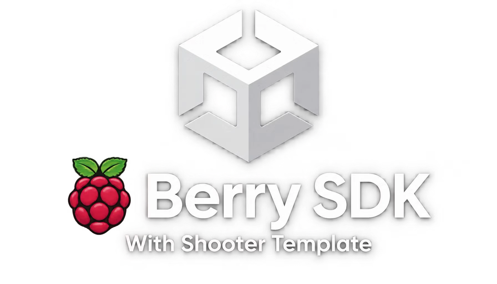

<p align="center"></p>

<p align="center"><a href="README.md">English</a></p>

<div dir="rtl">

# SDK تمشک برای یونیتی

## SDK تمشک چیست

SDK تمشک یک پکیج کوچک یونیتی است که بازی شما را به لانچر تمشک که روی همان کامپیوتر اجرا می‌شود وصل می‌کند. بعد از اضافه کردن آن، بازی می‌داند چه کسی بازی می‌کند، بازیکن در کدام اتاق است، چه کسان دیگری در اتاق هستند و باید به کدام آدرس وصل شود. لازم نیست برای این کارها صفحهٔ ورود، منو یا کد شبکهٔ جداگانه بنویسید.

همهٔ ارتباط روی خود کامپیوتر بازیکن و از یک اتصال محلی انجام می‌شود. بازی هیچ‌وقت رمز عبور، ایمیل، شمارهٔ تلفن یا آی‌پی واقعی بازیکن را نمی‌بیند. هر چیزی که بازی بخواهد بخواند باید در مجوزهای آن نوشته شده باشد و هر کاری که برای بازیکن تغییری ایجاد کند (مثل ساخت اتاق یا دعوت دوست) اول از خود بازیکن پرسیده می‌شود.

نسخهٔ فعلی 1.4.0 است و با یونیتی 2021.3 به بالا، از جمله یونیتی 6، روی ویندوز کار می‌کند.

## لانچر تمشک چیست

لانچر تمشک یک برنامهٔ ویندوزی برای بازی کردن بازی‌های شبکهٔ محلی به صورت آنلاین است. بین بازیکن‌ها یک شبکهٔ محلی مجازی می‌سازد، پس بازی‌ای که فقط می‌تواند دوستانش را در شبکهٔ محلی پیدا کند، با افرادی از شهرهای دیگر هم مثل یک اتاق مشترک کار می‌کند. لانچر اتاق، دوستان، گفتگوی صوتی، کتابخانهٔ بازی با به‌روزرسانی خودکار، مسابقات، باشگاه، رتبه‌بندی و فروشگاه هم دارد.

لانچر و اطلاعات بیشتر در https://berrylauncher.ir است.

بازی‌هایی که از SDK استفاده می‌کنند در لانچر یک نشان SDK می‌گیرند و می‌توانند مستقیم از حساب‌ها و اتاق‌های لانچر استفاده کنند.

## امکانات SDK

- اطلاعات بازیکن: نام نمایشی، کد تمشک، سطح اشتراک، کشور، باشگاه و نشان، تا جایی که مجوزها اجازه بدهند.
- اطلاعات اتاق: نام، نوع، قفل یا رایگان بودن، میزبان، حداکثر بازیکن، آدرسی که باید به آن وصل شد و نقش بازیکن فعلی (میزبان یا مهمان).
- فهرست بازیکن‌ها: همهٔ افراد اتاق با آماده بودن، قطع صدا، صدا، پینگ و کیفیت اتصال.
- رویدادهای زنده: کسی وارد یا خارج شد، اتاق تغییر کرد، لانچر بسته شد.
- کار با اتاق از داخل بازی: ساخت، ورود، خروج، فهرست اتاق‌های عمومی و ورود با شناسهٔ اتاق.
- وضعیت شبکه: آدرس مجازی شما، همتاها و پینگ‌ها.
- دوستان: خواندن فهرست دوستان با وضعیت آنلاین و دعوت از دوست به اتاقی که میزبانش هستید.
- وضعیت، دستاورد و امتیاز: نوشتن یک وضعیت کوتاه کنار نام بازیکن در لانچر، باز کردن دستاورد و ثبت امتیاز.
- توکن هویت: یک توکن امضاشده که سرور بازی خودتان می‌تواند بررسی کند تا مطمئن شود بازیکن واقعاً کیست.
- کارهای مدیریت اتاق برای بازی‌هایی که لازم دارند: اخراج، قطع صدا، گذاشتن رمز، بستن اتاق. هر بار از بازیکن پرسیده می‌شود.
- کارهای لانچر: آوردن لانچر به جلو، باز کردن یک صفحه از آن، باز کردن صفحهٔ ورود.
- حالت آزمایشی (Mock): وقتی در ادیتور یونیتی بدون لانچر Play می‌زنید، SDK داده‌های ساختگی می‌دهد و می‌توانید کل بازی را بدون بیرون رفتن از یونیتی بسازید و امتحان کنید.
- ابزارهای کمکی برای کیفیت پینگ، متن اشتراک، پیام‌های خطا به فارسی و انگلیسی و انتخاب بین UDP و TCP.

پکیج هیچ کتابخانهٔ بیرونی ندارد و هیچ فایلی نمی‌نویسد. فقط به 127.0.0.1 وصل می‌شود.

## نصب در یونیتی

از منوی Window وارد Package Manager شوید. روی دکمهٔ مثبت بزنید و Add package from git URL را بزنید. این آدرس را بچسبانید:

```
https://github.com/SajadAhmadiNiat/berrylauncher-unity-sdk.git?path=/Packages/com.berry.sdk#v1.4.0
```

برای نسخهٔ جدیدتر، قسمت بعد از علامت # را به تگ جدید تغییر دهید. اگر Git نصب ندارید، می‌توانید این مخزن را به صورت zip بگیرید، از حالت فشرده خارج کنید و با Add package from disk فایل Packages/com.berry.sdk/package.json را انتخاب کنید.

بعد از نصب، در Package Manager گزینهٔ Berry SDK را انتخاب کنید و اگر یک مثال کوچک می‌خواهید، Berry Arena را Import کنید.

## استفاده از SDK در یونیتی

1. تمشک را به صحنه اضافه کنید. از منوی Berry گزینهٔ Add Berry to scene را بزنید. یک شیء با کامپوننت BerryBehaviour ساخته می‌شود.
2. فیلدهای BerryBehaviour را پر کنید. Game Id شناسهٔ بازی شماست. اگر بازی را در پنل توسعه‌دهندگان ثبت کرده‌اید، Game Code و Game Number را هم از صفحهٔ SDK پنل وارد کنید.
3. فایل توضیح بازی را با منوی Berry و گزینهٔ Create berry-game.json بسازید. آن را ویرایش کنید و هنگام ساخت بیلد کنار exe بازی بگذارید.
4. کد خود را بنویسید:

```csharp
using BerrySdk;

void Start()
{
    Berry.Ready += OnBerryReady;
    Berry.ContextChanged += ctx => RefreshPlayers(ctx.Players);
}

void OnBerryReady()
{
    Debug.Log("Hello " + Berry.User.DisplayName);

    if (Berry.Room.Role == BerryRole.Guest)
        Connect(Berry.Room.HostAddress, 7777);
    else
        StartHosting(7777);

    Berry.SetPresence("In the lobby");
}
```

5. Play بزنید. در ادیتور لانچر وجود ندارد، پس Berry.IsMock برابر true است و داده‌های ساختگی می‌گیرید.

اگر ترجیح می‌دهید SDK را از کد خودتان و نه با کامپوننت راه بیندازید، Berry.InitAsync را با یک شیء BerryOptions که GameId و GameCode و GameNumber دارد صدا بزنید.

## فایل berry-game.json

این فایل کوچک کنار exe بازی می‌نشیند و به لانچر می‌گوید بازی شما چطور کار می‌کند. فیلدهای اصلی آن شناسهٔ بازی، نام نمایشی، نسخه، نام فایل اجرایی، حداکثر بازیکن، پورت بازی، پروتکل (udp، tcp یا both)، روش‌های اتصال بازیکن‌ها، آرگومان‌هایی که لانچر هنگام میزبانی یا ورود اضافه می‌کند و فهرست مجوزهای SDK است.

لانچر وقتی بازیکن میزبان است آرگومان -host و وقتی بازیکن وارد می‌شود آرگومان -connect را همراه آدرس و پورت میزبان می‌دهد. بازی شما این آرگومان‌ها را می‌خواند و حالت درست را شروع می‌کند. شِمای فایل در پوشهٔ schema و یک نمونه در پوشهٔ examples است. فایل خود را می‌توانید این‌طور بررسی کنید:

```
node tools/manifest-to-profile.mjs berry-game.json
```

فقط مجوزهایی را بخواهید که واقعاً استفاده می‌کنید. مجوزهای موجود identity، room، players، presence، achievements، scores، token، network، lan، friends و profile هستند. هر فیلدی که SDK برمی‌گرداند به یکی از این‌ها وابسته است و جدول کامل در docs/DATA-REFERENCE.md آمده.

## نمونه‌ها و قالب Shooter

در این مخزن دو نمونه هست.

Berry Arena یک نمونهٔ خیلی کوچک داخل پکیج است. دو اسکریپت دارد و هیچ فایل هنری ندارد. از Package Manager آن را Import کنید، کامپوننت Arena Bootstrap را به یک شیء خالی بدهید و Play بزنید. هر بخش SDK را ساده‌ترین شکل نشان می‌دهد.

Berry Shooter یک پروژهٔ کامل یونیتی در Samples/BerryShooter است. یک بازی تیراندازی موج‌به‌موج و همکاری برای تا هشت بازیکن است که فقط با مکعب و کپسول ساخته شده، صداها در کد تولید می‌شوند و کل رابط با اسکریپت به فارسی و انگلیسی ساخته می‌شود. به عنوان قالب طراحی شده تا آن را کپی کنید و به بازی خودتان تبدیل کنید. تقریباً همه‌چیز را پوشش می‌دهد: شروع از اتاق لانچر، ساخت و ورود به اتاق از داخل بازی، دو فهرست بازیکن، دوستان و دعوت، جزئیات پینگ و اتصال، دستاورد و امتیاز و انتخاب UDP یا TCP یا Auto. برای امتحان، پوشه را در Unity Hub باز کنید، از منوی Berry Shooter گزینهٔ Create the full main scene را بزنید و Play کنید. README خود پروژه کنترل‌ها و ساخت بیلد را توضیح می‌دهد و فایل docs/SDK-COVERAGE.md در آن نشان می‌دهد هر امکان SDK در کدام اسکریپت استفاده شده.

## توسعه با SDK

یک روند معمول این‌طور است.

- در ادیتور با حالت Mock شروع کنید. منوها و گیم‌پلی را طوری بسازید که انگار لانچر هست. داده‌های ساختگی از فیلدهای BerryBehaviour می‌آید (نام کاربری و میزبان بودن ساختگی).
- لانچر را منبع حقیقت بدانید. وقتی بازی شروع شد، صبر کنید تا Berry.Ready بیاید و بعد کاربر، اتاق و بازیکن‌ها را بخوانید. به ContextChanged گوش بدهید تا فهرست لابی تازه بماند.
- میزبان یا مهمان بودن را از Berry.Room.Role بفهمید. میزبان روی پورت بازی گوش می‌دهد. مهمان‌ها به Berry.Room.HostAddress وصل می‌شوند که یک آدرس خصوصی مجازی است.
- خطاها را مدیریت کنید. لانچر قدیمی، بسته یا بدون نشست، حالت‌های روشن در Berry.LinkState دارد و BerryUtil.ErrorText کد خطا را به متن قابل خواندن تبدیل می‌کند.
- برای رتبه‌بندی، خرید یا هر چیز مهم، هیچ‌وقت فقط به Berry.User اعتماد نکنید چون بازی دستکاری‌شده می‌تواند آن را جعل کند. توکن هویت بگیرید و روی سرور خودتان بررسی کنید. مراحلش در docs/SERVER-TOKENS.md و نمونه‌اش در examples/verify-token.mjs است.

اسکریپت‌های این پکیج عمداً کامنت ندارند. توضیحات در پوشهٔ docs است.

## توابع، پراپرتی‌ها و رویدادها

وضعیت و داده
- Berry.IsReady، Berry.IsMock، Berry.IsConnected، Berry.IsHost، Berry.IsLoggedIn، Berry.IsInRoom
- Berry.User، Berry.Room، Berry.Players، Berry.Profile، Berry.Network، Berry.Game، Berry.Launcher، Berry.Context
- Berry.LinkState نشان می‌دهد وصل هستید، در حالت Mock هستید یا لانچر باز ولی بدون نشست یا بسته است
- میان‌برهایی مثل Berry.IsFreeConnection، Berry.IsRoomOpen، Berry.IsVoiceActive، Berry.RoomMemberCount، Berry.InstalledVersion و Berry.IsDownloadedFromBerry

رویدادها، همه روی رشتهٔ اصلی
- Berry.Ready، Berry.ContextChanged، Berry.Pushed، Berry.Disconnected

فراخوانی‌های ساده
- Berry.SetPresence(text)
- Berry.UnlockAchievement(id, title)
- Berry.SubmitScore(board, value)
- Berry.LeaveRoom()
- Berry.SendCustom(name, data)

فراخوانی‌های ناهمزمان با await
- هویت: GetIdentityTokenAsync(audience)، LogoutAsync()
- اتاق‌ها: HostLanAsync، JoinLanAsync، LeaveLanAsync، GetLanStatusAsync، ListRoomsAsync، JoinRoomAsync
- شبکه: GetNetworkAsync()
- دوستان: GetFriendsAsync()، InviteFriendAsync(username)
- پرس‌وجوی پروفایل: GetProfileAsync، CheckFollowAsync، DoesFollowAsync، HasAchievementAsync، ListAchievementsAsync، GetClubAsync، ListTournamentsAsync، GetTournamentAsync، GetAccountAsync، GetSettingsAsync
- مدیریت اتاق: KickAsync، MuteAsync، SetRoomAdminAsync، SetRoomPasswordAsync، SetRoomStatusAsync، SetMaxPingAsync، SetRequireReadyAsync، SetLaunchModeAsync، CloseRoomAsync
- لانچر: ShowLauncherAsync، OpenLauncherPageAsync(page)، OpenLoginAsync، OpenForgotPasswordAsync

کلاس‌های کمکی
- BerryUtil ابزار رده و رنگ اشتراک، کیفیت و متن پینگ، بررسی آدرس خصوصی، اعتبارسنجی اتاق، متن خطا، انتظار برای شبکه و انتخاب پروتکل را دارد
- BerryTransport و BerryUtil.ChooseTransport بین UDP، TCP و Auto انتخاب می‌کنند و وقتی تمشک بگوید اتصال از رله می‌گذرد به TCP برمی‌گردند

کلاس‌های داده BerryUser، BerryRoom، BerryPlayer، BerryProfile، BerryNetwork، BerryGame، BerryLauncher و BerryContext هستند. هر فیلد و مجوز لازم برای آن در docs/DATA-REFERENCE.md آمده.

## تست کردن

در ادیتور یونیتی فقط Play بزنید. SDK در حالت Mock است و می‌توانید همه‌چیز را بدون لانچر بسازید. برای تست بخش شبکه از دو نسخه استفاده کنید، مثلاً یک ادیتور و یک بیلد، با نام بازیکن متفاوت.

برای تست به عنوان یک بازی واقعی تمشک این مراحل را بروید.

1. بازی را برای ویندوز بسازید و berry-game.json را کنار exe بگذارید.
2. در لانچر بازی را به صورت بازی سفارشی اضافه کنید یا یک اتاق آزاد بسازید و exe را انتخاب کنید.
3. یک اتاق بسازید، از دوستتان بخواهید وارد شود و بازی را از داخل اتاق اجرا کنید.
4. داخل بازی بررسی کنید لانچر باز گزارش شود، نام بازیکن درست باشد، نام اتاق دیده شود و بقیهٔ بازیکن‌ها با پینگ بیایند.

اگر بازی می‌گوید لانچر باز است ولی نشست ندارد، دلیل معمول این است که berry-game.json نیست یا معتبر نیست، شناسهٔ بازی فرق دارد یا بازی با دابل‌کلیک و نه از لانچر اجرا شده.

پکیج تست‌های PlayMode هم در پوشهٔ Tests دارد. از منوی Window، بخش General، Test Runner را باز کنید، PlayMode را انتخاب کنید و Berry SDK Tests را اجرا کنید. جزئیات بیشتر در docs/TESTING.md است.

## نسخهٔ SDK

نسخهٔ SDK در package.json و ثابت SdkVersion نوشته شده و الان 1.4.0 است. نسخهٔ پروتکل بین SDK و لانچر 1 است و ثابت می‌ماند، پس لانچرهای قدیمی‌تر هم کار می‌کنند و فقط به درخواست‌های جدید پیام unsupported می‌دهند که بازی شما می‌تواند آن را مدیریت کند. تغییرات هر نسخه در docs/CHANGELOG.md است.

نکتهٔ صادقانه: کد C# بدون کامپایلر یونیتی نوشته و بررسی شده و پروتکل با کلاینت Node روی هستهٔ واقعی لانچر تست شده است. اگر هنگام اولین Import پیام خطای کامپایل دیدید، لطفاً متن آن را در Issues بگذارید.

## افزودن بازی به لانچر تمشک

1. بازی را بسازید و همان‌طور که بالا گفته شد با لانچر تست کنید.
2. در https://berrylauncher.ir با حساب تمشک وارد شوید و پنل توسعه‌دهندگان را در https://berrylauncher.ir/dev باز کنید.
3. فرم توسعه‌دهنده را پر کنید و قرارداد را امضا کنید. قرارداد با کدی که به تلفن شما پیامک می‌شود امضا می‌شود. بر اساس تنظیمات سایت، ممکن است حق قراردادی سالانه یا ماهانه هم لازم باشد.
4. بازی را در پنل ثبت کنید. کد بازی و شمارهٔ بازی را می‌گیرید و صفحهٔ SDK پنل berry-game.json و مقادیر کامپوننت BerryBehaviour را به شما می‌دهد.
5. یک نسخه از بازی را بارگذاری کنید. پنل فایل بیلد یا لینک آن و SHA-256 فایل را می‌خواهد. بیلد را در virustotal.com اسکن کنید و هش را وارد کنید. الزامی بودن این کار به تنظیمات سایت بستگی دارد.
6. بازی را برای بررسی بفرستید. بعد از تأیید مدیر، نسخه را منتشر کنید تا بازیکن‌ها بازی شما را با نشان SDK در لانچر ببینند. نسخه‌های بعدی به صورت به‌روزرسانی خودکار به بازیکن‌ها می‌رسد.
7. در پنل می‌توانید فروش و سهم خود، آمار اتاق‌ها و بازیکن‌ها را ببینید و برای بالاتر آمدن بازی در فهرست‌ها تبلیغ سفارش بدهید.

پنل یک پایگاه دانش دارد که هر مرحله را دقیق‌تر توضیح می‌دهد. یک ابزار خط فرمان هم در node/berry-dev.mjs هست که می‌تواند نسخه بارگذاری کند، هش VirusTotal بفرستد و مقادیر SDK را بگیرد:

```
node node/berry-dev.mjs sdk my-game
node node/berry-dev.mjs release my-game --version 1.0.1 --url https://example.com/game.zip --sha256 HASH --vt VT_HASH --publish
```

اول متغیر محیطی BERRY_DEV_TOKEN را با توکنی که از پنل می‌گیرید مقداردهی کنید. این توکن را هیچ‌وقت در جای عمومی نگذارید.

## موتورهای دیگر

پروتکل کوچک است و در docs/PROTOCOL.md توضیح داده شده. یک کلاینت مرجع کوتاه برای Node در node/berry-sdk.mjs هست که می‌توانید برای شروع کار با آنریل، گودو یا موتور اختصاصی استفاده کنید.

## محتویات این مخزن

- Packages/com.berry.sdk پکیج یونیتی
- Samples/BerryShooter پروژهٔ کامل قالب
- docs پروتکل، امنیت، اتاق‌ها، مرجع داده، انتقال، تست، انتشار و تاریخچهٔ تغییرات
- node کلاینت Node و ابزار خط فرمان توسعه‌دهندگان
- schema و examples و tools شِمای berry-game.json، نمونه و ابزار بررسی
- images بنر و آیکون

## امنیت به‌طور خلاصه

SDK فقط به 127.0.0.1 وصل می‌شود. توکن نشست تصادفی است و فقط تا وقتی بازی باز است زنده می‌ماند. لانچر فقط فیلدهایی را که مجوزها اجازه می‌دهند به بازی می‌دهد و در هستهٔ خودش دوباره بررسی می‌کند. جزئیات در docs/SECURITY.md است.

## پشتیبانی و مجوز

پرسش‌ها و مشکلات را به صورت Issue در همین مخزن یا از راه https://berrylauncher.ir بفرستید. کد با مجوز MIT منتشر شده، فایل LICENSE را ببینید. نام و آیکون تمشک متعلق به پروژهٔ تمشک است.

</div>
