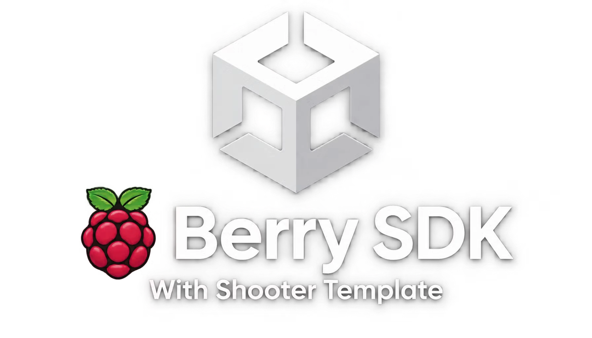

<p align="center"></p>

<p align="center"><a href="README.fa.md">نسخهٔ فارسی</a></p>

# Berry SDK for Unity

## What is the Berry SDK

The Berry SDK is a small Unity package that lets your game talk to the Berry Launcher running on the same computer. Once it is added, your game knows who is playing, which room the player is in, who else is in that room and what address to connect to, without you writing any menu, login screen or networking glue for it.

Everything works through a local connection on the player's own machine. The game never sees a password, an email, a phone number or a real IP address. Whatever the game wants to read must be listed in its permissions, and whatever changes something for the player (creating a room, inviting a friend) asks the player first.

The current version is 1.4.0. It works with Unity 2021.3 and newer, including Unity 6, on Windows.

## What is Berry Launcher

Berry Launcher is a Windows app for playing LAN games online. It builds a virtual LAN between players, so a game that only knows how to find friends on a local network can be played with people in other cities as if they were in the same room. It also has rooms, friends, voice, a game library with automatic updates, tournaments, clubs, ranking and a store.

You can get the launcher and read more about it at https://berrylauncher.ir

Games that use the SDK get a small SDK badge in the launcher and can use the launcher's accounts and rooms directly.

## What the SDK gives you

- Player data: display name, Berry code, level of subscription, country, club and badge, as far as the permissions allow.
- Room data: room name, type, whether it is locked or free, host, maximum players, the host address to connect to and the role of the current player (host or guest).
- Player list: everyone in the room with ready state, mute state, voice state, ping and connection quality.
- Live events: someone joined, someone left, the room changed, the launcher closed.
- Rooms from inside the game: create, join, leave, list public rooms and join one by its id.
- Network state: your virtual address, peers and ping values.
- Friends: read the friend list with online state and invite a friend to the room you host.
- Presence, achievements and scores: show a short status next to the player's name in the launcher, unlock achievements and submit scores.
- Identity token: a signed token your own game server can verify, so your server knows who the player really is.
- Room admin actions for games that need them: kick, mute, set password, close the room. The player is asked every time.
- Launcher actions: bring the launcher to the front, open a page in it, open the login page.
- Mock mode: when you press Play in the Unity editor without the launcher, the SDK gives you fake data so you can build and test the whole game without leaving Unity.
- Text and network helpers for ping quality, subscription text, error messages in Persian and English, and choosing between UDP and TCP.

The package contains no outside libraries and writes no files. It only connects to 127.0.0.1.

## Install in Unity

Open Window, then Package Manager. Click the plus button and choose Add package from git URL. Paste this address:

```
https://github.com/SajadAhmadiNiat/berrylauncher-unity-sdk.git?path=/Packages/com.berry.sdk#v1.4.0
```

To use a newer version later, change the part after the hash sign to the new tag. If you do not have Git installed, you can download this repository as a zip, extract it, and use Add package from disk, then choose Packages/com.berry.sdk/package.json.

After the package is in, open Package Manager, select Berry SDK and import the sample named Berry Arena if you want a small working example.

## Use the SDK in Unity

1. Add Berry to your scene. Use the menu Berry, then Add Berry to scene. This creates an object with the BerryBehaviour component.
2. Fill the fields on BerryBehaviour. Game Id is the id of your game. If you registered the game in the developer panel, also fill Game Code and Game Number from the panel's SDK page.
3. Create the game description file with the menu Berry, then Create berry-game.json. Edit it and put it next to your game's exe when you build.
4. Write your code:

```csharp
using BerrySdk;

void Start()
{
    Berry.Ready += OnBerryReady;
    Berry.ContextChanged += ctx => RefreshPlayers(ctx.Players);
}

void OnBerryReady()
{
    Debug.Log("Hello " + Berry.User.DisplayName);

    if (Berry.Room.Role == BerryRole.Guest)
        Connect(Berry.Room.HostAddress, 7777);
    else
        StartHosting(7777);

    Berry.SetPresence("In the lobby");
}
```

5. Press Play. In the editor there is no launcher, so Berry.IsMock is true and you get fake data.

If you prefer to start the SDK from your own code instead of the component, call Berry.InitAsync with a BerryOptions object that has GameId, GameCode and GameNumber.

## The berry-game.json file

This small file sits next to your exe and tells the launcher how your game works. The main fields are the game id, display name, version, the executable name, maximum players, the game port, the protocol (udp, tcp or both), the ways players can connect, the arguments the launcher adds when someone hosts or joins, and the list of SDK permissions.

The launcher adds -host when the player hosts and -connect with the host address and port when the player joins. Your game reads those arguments and starts the right mode. A schema is in the schema folder and an example is in the examples folder. You can check your file with:

```
node tools/manifest-to-profile.mjs berry-game.json
```

Ask only for the permissions you really use. The available ones are identity, room, players, presence, achievements, scores, token, network, lan, friends and profile. Every field the SDK returns is tied to one of them, and the full table is in docs/DATA-REFERENCE.md.

## Samples and the Shooter template

There are two examples in this repository.

Berry Arena is a tiny sample inside the package. It has two scripts and no assets. Import it from Package Manager, add the Arena Bootstrap component to an empty object and press Play. It shows each part of the SDK in the simplest way.

Berry Shooter is a full Unity project in Samples/BerryShooter. It is a small co-op wave shooter for up to eight players, made only from cubes and capsules, with sounds generated in code and the whole interface built by script in Persian and English. It is meant as a template you can copy and change into your own game. It covers almost everything: starting from a room in the launcher, creating and joining rooms from inside the game, two player lists, friends and invitations, ping and connection details, achievements and scores, and choosing UDP, TCP or Auto. To try it, open the folder in Unity Hub, use the menu Berry Shooter, Create the full main scene, and press Play. Its own README explains the controls and building. The file docs/SDK-COVERAGE.md inside it shows which SDK feature is used in which script.

## Developing with the SDK

A normal flow looks like this.

- Start in the editor with mock mode. Build your menus and gameplay as if the launcher were there. Mock data comes from the BerryBehaviour fields (mock username, mock host).
- Treat the launcher as the source of truth. When the game starts, wait for Berry.Ready, then read the user, room and players. Listen to ContextChanged to keep your lobby list fresh.
- Decide host or guest from Berry.Room.Role. The host listens on the game port. Guests connect to Berry.Room.HostAddress, which is a private virtual address.
- Handle failures. A launcher that is old, closed or without a session gives clear states in Berry.LinkState, and BerryUtil.ErrorText turns error codes into readable text.
- For ranking, purchases or anything that matters, never trust Berry.User on its own, because it can be faked by a modified game. Ask for an identity token and verify it on your own server. The steps are in docs/SERVER-TOKENS.md and an example is in examples/verify-token.mjs.

Scripts in this package have no comments on purpose. The explanations live in the docs folder.

## Functions, properties and events

State and data
- Berry.IsReady, Berry.IsMock, Berry.IsConnected, Berry.IsHost, Berry.IsLoggedIn, Berry.IsInRoom
- Berry.User, Berry.Room, Berry.Players, Berry.Profile, Berry.Network, Berry.Game, Berry.Launcher, Berry.Context
- Berry.LinkState tells you if you are connected, in mock mode, or if the launcher is open without a session or closed
- Shortcuts such as Berry.IsFreeConnection, Berry.IsRoomOpen, Berry.IsVoiceActive, Berry.RoomMemberCount, Berry.InstalledVersion and Berry.IsDownloadedFromBerry

Events, all raised on the main thread
- Berry.Ready, Berry.ContextChanged, Berry.Pushed, Berry.Disconnected

Simple calls
- Berry.SetPresence(text)
- Berry.UnlockAchievement(id, title)
- Berry.SubmitScore(board, value)
- Berry.LeaveRoom()
- Berry.SendCustom(name, data)

Async calls, used with await
- Identity: GetIdentityTokenAsync(audience), LogoutAsync()
- Rooms: HostLanAsync, JoinLanAsync, LeaveLanAsync, GetLanStatusAsync, ListRoomsAsync, JoinRoomAsync
- Network: GetNetworkAsync()
- Friends: GetFriendsAsync(), InviteFriendAsync(username)
- Profile queries: GetProfileAsync, CheckFollowAsync, DoesFollowAsync, HasAchievementAsync, ListAchievementsAsync, GetClubAsync, ListTournamentsAsync, GetTournamentAsync, GetAccountAsync, GetSettingsAsync
- Room admin: KickAsync, MuteAsync, SetRoomAdminAsync, SetRoomPasswordAsync, SetRoomStatusAsync, SetMaxPingAsync, SetRequireReadyAsync, SetLaunchModeAsync, CloseRoomAsync
- Launcher: ShowLauncherAsync, OpenLauncherPageAsync(page), OpenLoginAsync, OpenForgotPasswordAsync

Helper classes
- BerryUtil has helpers for subscription tiers and colors, ping quality and text, private address checks, room validation, error text, waiting for the network and choosing the transport
- BerryTransport and BerryUtil.ChooseTransport pick UDP, TCP or Auto, and fall back to TCP when Berry says the link goes through a relay

Data classes are BerryUser, BerryRoom, BerryPlayer, BerryProfile, BerryNetwork, BerryGame, BerryLauncher and BerryContext. Every field and the permission it needs is listed in docs/DATA-REFERENCE.md.

## Testing

In the Unity editor, just press Play. The SDK is in mock mode, so you can build everything without the launcher. To test the network part use two copies, for example one editor and one build, with different player names.

To test as a real Berry game, follow these steps.

1. Build your game for Windows and put berry-game.json in the same folder as the exe.
2. In the launcher, add the game as a custom game or use a free room and choose the exe.
3. Create a room, let a friend join it and start the game from the room.
4. Inside the game, check that the launcher is reported open, the player name is correct, the room name shows and the other players appear with their ping.

If the game says the launcher is open but there is no session, the usual reasons are a missing or invalid berry-game.json, a different game id, or starting the game by double click instead of from the launcher.

The package also has PlayMode tests in the Tests folder. Open Window, then General, then Test Runner, choose PlayMode and run Berry SDK Tests. More details are in docs/TESTING.md.

## SDK version

The SDK version is written in package.json and in the SdkVersion constant. It is 1.4.0 now. The protocol version between the SDK and the launcher is 1 and stays the same, so older launchers keep working and simply answer newer requests with an unsupported message that your game can handle. What changed in each release is in docs/CHANGELOG.md.

Honest note: the C# code was written and checked without a Unity compiler, and the protocol was tested against the real launcher core with the Node client. If you see a compile message when you first import the package, please open an issue with the text of the message.

## Adding your game to Berry Launcher

1. Build your game and test it with the launcher as described above.
2. Sign in at https://berrylauncher.ir with your Berry account and open the developer panel at https://berrylauncher.ir/dev.
3. Fill in the developer form and sign the contract. The contract is signed with a code sent to your phone. Depending on the settings of the site, a yearly or monthly contract fee may apply.
4. Register your game in the panel. You get a game code and a game number, and the panel's SDK page gives you berry-game.json and the values for the BerryBehaviour component.
5. Upload a version of your game. The panel needs the build as a file or a link, and the SHA-256 of the file. Scan the build on virustotal.com and enter the hash from the scan. Whether this is required depends on the site settings.
6. Send the game for review. After the owner approves it, you can publish the version and players will see your game in the launcher with the SDK badge. New versions reach players as automatic updates.
7. In the panel you can also see your sales and your share, statistics for rooms and players, and order promotions to put your game higher in the lists.

The panel has a knowledge base that explains each step in more detail. There is also a command line tool for developers in node/berry-dev.mjs, which can upload versions, send the VirusTotal hash and fetch the SDK values:

```
node node/berry-dev.mjs sdk my-game
node node/berry-dev.mjs release my-game --version 1.0.1 --url https://example.com/game.zip --sha256 HASH --vt VT_HASH --publish
```

Set the environment variable BERRY_DEV_TOKEN to the token from the panel first. Never put this token in a public place.

## Other engines

The protocol is small and documented in docs/PROTOCOL.md. A short reference client for Node is in node/berry-sdk.mjs, and you can use it as a starting point for Unreal, Godot or a custom engine.

## What is in this repository

- Packages/com.berry.sdk is the Unity package
- Samples/BerryShooter is the full template project
- docs has the protocol, security, rooms, data reference, transport, testing, publishing and the changelog
- node has the Node client and the developer command line tool
- schema, examples and tools have the berry-game.json schema, an example and a checker
- images has the banner and the icon

## Security in short

The SDK connects only to 127.0.0.1. The session token is random and lives only while the game runs. The launcher gives a game only the fields its permissions allow, and checks them again in its core. Details are in docs/SECURITY.md.

## Support and license

Questions and problems can be opened as issues in this repository or sent through https://berrylauncher.ir. The code is released under the MIT license, see LICENSE. The Berry name and icon belong to the Berry project.
