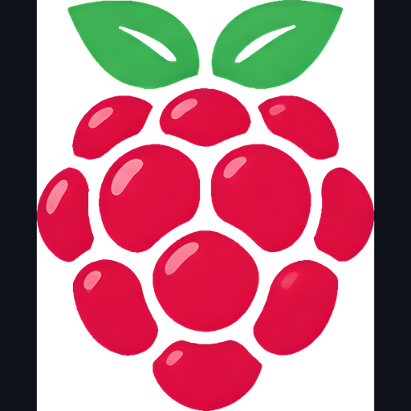

# Berry Shooter

A small co-op wave shooter for **Windows PC**, built only from Unity cubes and capsules (no models, sprites or audio files - sounds are generated in code). It is the **reference project for the [Berry SDK for Unity](../../docs/README.md)**: the UI is created by code, and almost every SDK feature is used.

> Honest note: the C# was written without a Unity compiler. It is lint-checked, not compiled. Open it once in Unity and report any compile message in Issues.

## Features
* Solo, create a room, join a room (up to 8 players, host-authoritative, 30 Hz, port 7777).
* **Connection**: from the Berry launcher (room started the game), from inside the game (room list, room code, create room), or by IP address. UDP, TCP or **Auto** (UDP first, switches to TCP when UDP does not work or Berry reports a relay).
* **Two player lists** in the lobby: everyone in the Berry room, and everyone who joined the match; click a player for all details (role, admin level, nation, subscription, ping, latency, jitter, loss...).
* **Information tabs**: launcher (open, signed in, connected, official, version, uptime), account (identity, tick, club, nation, subscription end), room (type, link, code, game, host, admins), network, friends, SDK lab.
* **Persian and English UI**, switchable at runtime (own text shaper: joined letters, right-to-left, line breaking; no extra package). Follows the launcher language the first time.
* Works in **Unity 2021.3 LTS and Unity 6 (6000.0)**, Built-in pipeline (URP/HDRP also render: the game ships its own tiny shader).
* No comments in scripts; all explanations live in `docs/`.

## Quick start
1. Install **Unity 2021.3 LTS or Unity 6 (6000.0.x)** with Windows Build Support.
2. Unity Hub > Add > select this folder. Wait for the import.
3. Menu **Berry Shooter > 2. Create the full main scene**, then press **Play** (mock mode: fake Berry data).
4. If keys do nothing: Edit > Project Settings > Player > Other Settings > **Active Input Handling = Both**.
5. Build: **Berry Shooter > 3. Build Windows (x64) + copy berry-game.json**.

Docs: [guide (Persian)](docs/GUIDE.fa.md) - [architecture](docs/ARCHITECTURE.md) - [SDK coverage](docs/SDK-COVERAGE.md) - [GitHub setup (Persian)](docs/GITHUB_SETUP.fa.md) - SDK docs: `../../docs/` (PROTOCOL, SECURITY, TRANSPORT, ROOMS, TESTING, DATA-REFERENCE).

## Controls
| Key | Action |
|---|---|
| W A S D | move |
| Mouse | look |
| Left mouse | fire |
| Space | jump |
| Left Shift | sprint |
| Tab (hold) | scoreboard (name, tick, ping) |
| Esc | pause / release the cursor |

## Launch arguments (`berry-game.json`)
| Argument | Meaning |
|---|---|
| `-host` | start hosting at once (port from Settings, default 7777) |
| `-connect <ip>:<port>` | join that address at once (Berry puts the host's virtual address here) |

## The Berry SDK
The SDK lives in `Packages/com.berry.sdk` (an embedded copy so the project opens anywhere). To update it from the main repo: `node tools/sync-sdk.mjs <path-to-berry-repo>`. This version uses **SDK 1.3.0**.

## License
MIT - see [LICENSE](LICENSE). The Berry name and icon belong to the Berry project.
